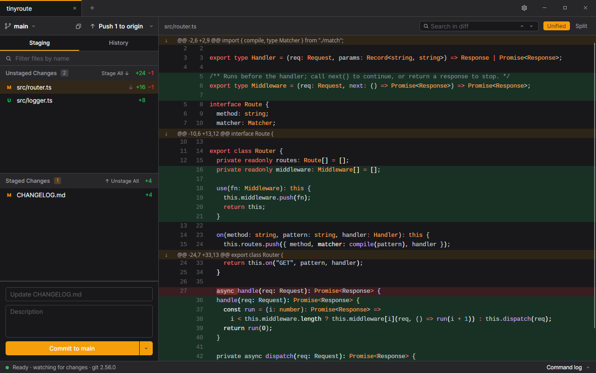
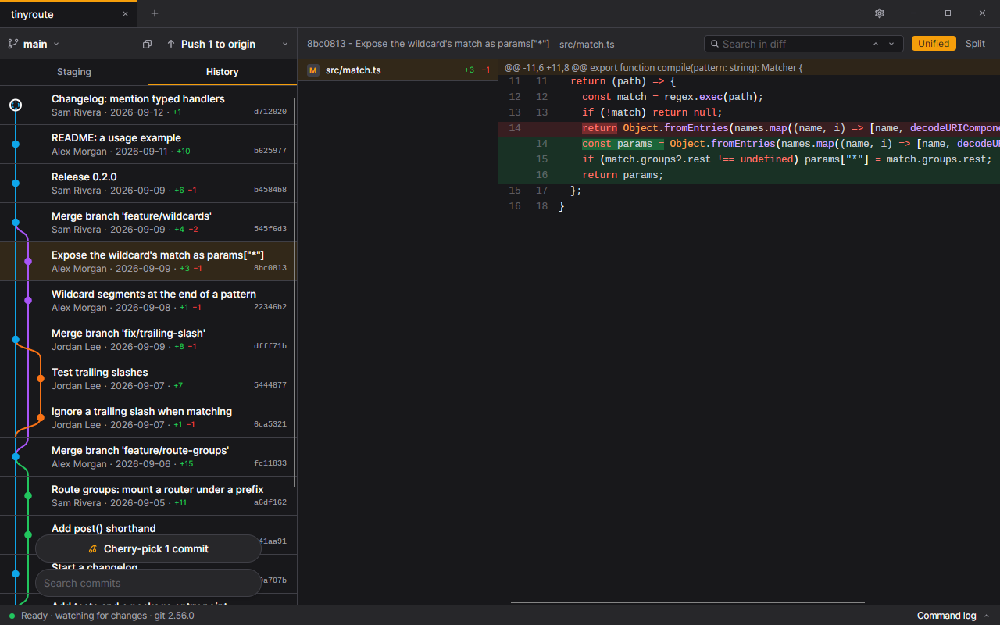
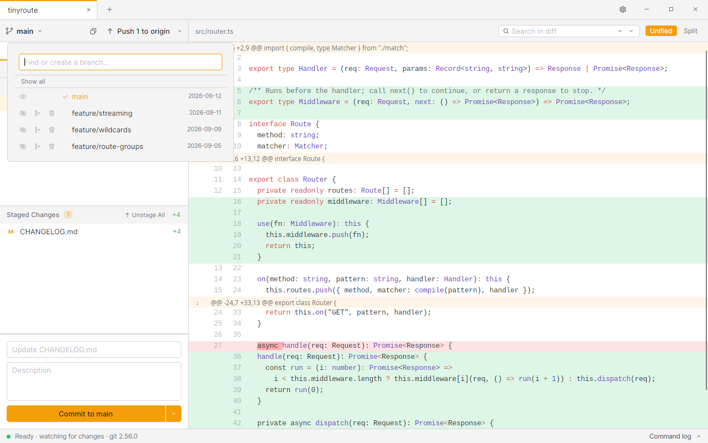

# CheeseGit

[](https://github.com/LPeter1997/CheeseGit/releases/latest)
[](https://github.com/LPeter1997/CheeseGit/releases)
[](https://github.com/LPeter1997/CheeseGit/actions/workflows/ci.yml)
[](LICENSE)


CheeseGit is a completely free and open-source git GUI client. It aims to give you the same experience on every
platform: Windows, macOS and Linux (X11 and Wayland) all get the same app, with the same look and the same features.



## Features

- **Staging:** stage and unstage whole files or single lines, discard changes, commit, and undo the last commit.
- **Diffs:** unified or split, with syntax highlighting and search. Images are shown side by side, and Git LFS files
  show their contents rather than their pointers.
- **History:** a commit graph that loads large histories quickly. You can search the whole history, choose which
  branches to show, and check out any commit.
- **Branches:** find, switch, create and delete branches, and merge with a warning when a conflict is coming.
- **Remotes:** fetch, pull, push and publish with progress and cancel. Credentials, passphrases and host keys are
  asked for in the app.
- **Cherry-pick and revert** one or more commits from the history.
- **Conflicts:** pick the current side, the incoming side or both, or open your own merge tool.
- **Stash**, light, dark and high-contrast themes, and in-app updates.





## Download

Get the latest version from the [releases page](https://github.com/LPeter1997/CheeseGit/releases/latest). Every
platform has x64 and arm64 builds.

| Platform | Package | Updates |
|---|---|---|
| Windows | `Setup.exe` (installs for the current user, no admin rights needed) or a portable zip | In the app |
| macOS | `.pkg`, `.dmg` or zip | In the app |
| Linux | AppImage | In the app |
| Linux | `.deb`, `.rpm` or a tarball | Through your package manager; the app tells you when a new version is out |

CheeseGit uses the git you already have installed, so git 2.34 or newer must be on your `PATH`. On Windows, that
means [Git for Windows](https://gitforwindows.org/).

Versions up to 0.6.2 were an earlier app built with Tauri. Their built-in updater cannot install this version, so
download it from the releases page instead. CheeseGit picks up your open repositories and settings from the old app.

## Building from source

You need the [.NET 10 SDK](https://dotnet.microsoft.com/download) and git.

```sh
cd src
dotnet build
dotnet test
dotnet run --project CheeseGit.App
```

The release builds use Native AOT: a native executable and a few native libraries, with no .NET runtime to install:

```sh
dotnet publish CheeseGit.App -c Release -r linux-x64 -o out   # or win-x64, osx-arm64, ...
```

`docs/` describes the architecture, how each feature behaves, testing, performance, releases and the roadmap.

## License

[MIT](LICENSE)
